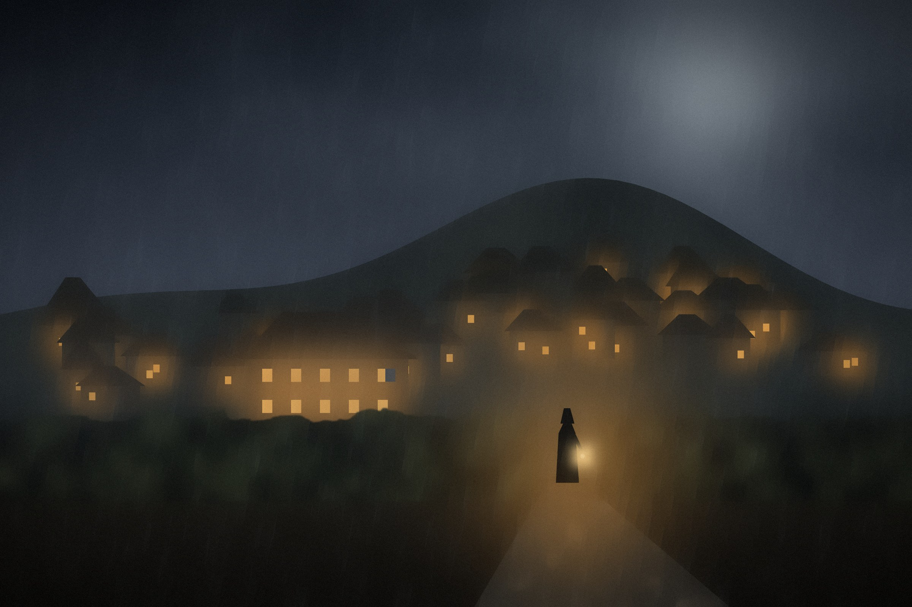

# Die Notizen des Fremden



Ein Abenteuer für *The One Ring, 2nd Edition* · Bree-land, Herbst TA 2968.

Ein Krimi-One-Shot für 3–4 Spieler (4–5 Stunden) im Bree-land: In der Nacht nach dem Herbstmarkt wird
im Prancing Pony ein Händler aus dem Süden erschlagen, und ganz Bree weiß, dass es der Ranger war, der
am Abend mit ihm stritt. Der Ranger bittet die Helden, seine Unschuld zu beweisen. Vier Tage, bis das
Thing der Hausväter über ihn urteilt – mit Wegen nach Staddle, Combe, Archet und in den Chetwood.

Dieses Repository enthält den Text des Abenteuers und die Pipeline, die daraus die
Druckfassung baut. Sie ist von [tor2e-graufieber](https://github.com/Andx667/tor2e-graufieber)
und [tor2e-finsterwacht](https://github.com/Andx667/tor2e-finsterwacht) übernommen. Bei jedem
Commit baut GitHub Actions die PDFs (Reiter **Actions** → letzter Lauf → Artefakte
`Notizen-des-Fremden-TOR2e-DE-v….pdf` und `Notizen-des-Fremden-TOR2e-DE-Buch-v….pdf`).

## Was drin ist

- **Abenteuertext** mit Hintergrund, Zeitleiste, Abenteuerkalender, drei Teilen, Höhepunkt und NSC-Anhang
- **Hinweismatrix**: 15 Beweisstücke, drei Schlüsse (Harnil war es nicht · Fenn war ein Spitzel ·
  Edric war es), jeder auf mindestens fünf Wegen erreichbar – als Tabelle und als Schaubild
- **Schaubild der Personen**: wer zu wem gehört, wer was gesehen hat
- **Ermittlungsstand** für den Loremaster: ein Bogen zum Abhaken – Beweise, Gespräche, die Uhr bis
  zum Thing, die Erfolge im *Council*
- **15 Beweiskarten** zum Ausschneiden (6 je Seite): was die Helden sehen, nicht was es beweist
- **Ermittlungsbogen** für die Spieler (Handout): Personen, die Mordnacht, Orte, Fundstücke, offene Fragen
- **Karten**: Bree-land, das Obergeschoss des Pony mit Stallhof, Edrics Hof – Loremaster-Fassung mit
  Nummern und Geheimnissen, Bree-land und Pony auch als Spielerfassung
- **Handouts**: Brief an Fenn, Seite aus Fenns Notizbuch

## Aufbau

| Pfad | Inhalt |
| --- | --- |
| `src/fremder.md` | Der Abenteuertext (Pandoc-Markdown) – hier wird geschrieben |
| `latex/karten.tex` | Die Beweiskarten |
| `latex/ermittlung.tex` | Der Bogen *Ermittlungsstand* für den Loremaster |
| `latex/inhalt.tex` | Inhalt beider Fassungen: Titel, Karten, Handouts, Ermittlungsbogen der Spieler |
| `latex/fremder.sty` | Das Layout: Ränder, Notizspalte, Kästen, Tabellen, Karten, Handouts, Beweiskarten |
| `latex/fremder.tex` | Gerüst der Blattfassung (einseitig, links gelocht) |
| `latex/fremder-buch.tex` | Gerüst der Buchfassung (Buchblock zum Binden) |
| `filters/fremder.lua` | Pandoc-Filter: Markdown-Elemente → Layout-Bausteine |
| `assets/maps/` | Die gezeichneten Karten als JPG, Quellen als SVG in `svg/` |
| `assets/diagrams/` | Schaubilder: Personen und Beweise |
| `assets/route-de.*` | Das Routendiagramm im Überblick |
| `assets/cover-de.jpg` | Titelbild der Buchfassung (gemalt von `tools/cover.py`) |
| `tools/build.py` | Baut das PDF |
| `tools/maps.py` | Zeichnet Karten, Routendiagramm und Schaubilder neu (optional, braucht Playwright und Pillow) |
| `tools/cover.py` | Malt das Titelbild neu (numpy, OpenCV) |
| `.github/workflows/build.yml` | CI: baut das PDF bei jedem Commit |
| `NOTICE.md` | Wem die Namen und Inhalte gehören und was die MIT-Lizenz abdeckt |

## Schreibregeln im Markdown

- `## Kapitel {#id}` beginnt ein Kapitel auf neuer Seite mit Notizspalte;
  `{#id .nonotes}` setzt es ohne Notizspalte in voller Breite.
- `### Abschnitt` ist eine Zwischenüberschrift.
- Absätze, die mit einem dieser fetten Labels beginnen, werden zu Kästen:
  **Hinweis für den Loremaster:**, **Optionale Erweiterung – …:**,
  **Erinnerung für den Loremaster – …:**, **Möglicher Abschluss:**,
  **Wenn sie …:** (z. B. **Wenn sie trotzdem gehen:**), **Erfahrung:**
- Ein Absatz **Hausregel – …:** mit folgender Liste und folgendem Absatz wird zum
  gerahmten Hausregel-Kasten.
- Die Wörter `Optional` und `Überspringbar` werden zur grauen Markierung.
- Bilder: `{.map}` für Karten, `{.route}` für das Routendiagramm, `{.diagram}` für breite Schaubilder.
- Briefe: `::: {.letter #id} … :::` mit `\` am Zeilenende und `[Unterschrift]{.sig}`;
  sie erscheinen im Text und zusätzlich als Handout-Seite (`\fwhandoutletter` in `latex/inhalt.tex`).
- Tabellen: normale Pipe-Tabellen; die Spaltenbreiten richten sich nach dem ersten
  Spaltenkopf (siehe `TABLES` im Filter).
- Regelbegriffe kursiv (`*Insight*`), Tolkien-Namen und Regelbegriffe bleiben englisch.
- Wer ein Beweisstück ändert, ändert es an vier Stellen: Text, Tabelle in *Die Beweisstücke*,
  `latex/karten.tex`, `latex/ermittlung.tex` – und das Schaubild in `tools/maps.py`.

## Version und Stand

Version und Datum in der Fußzeile kommen aus git: die Nummer des letzten Tags (`v1.0` →
**Version 1.0**) und das Datum des letzten Commits. Ein Tag `v*` erzeugt zusätzlich ein
GitHub-Release mit beiden PDFs:

```sh
git tag v1.1
git push --tags
```

## Blattfassung und Buchfassung

- **Blattfassung** (`Notizen-des-Fremden-TOR2e-DE-v….pdf`): lose Blätter für den Ordner, 26 mm Rand
  links für die Lochung, Karten und Handouts im Querformat.
- **Buchfassung** (`Notizen-des-Fremden-TOR2e-DE-Buch-v….pdf`): Buchblock zum Binden, doppelseitig;
  Querseiten stehen gedreht, Notizseiten füllen auf eine durch 4 teilbare Seitenzahl auf.

## Lokal bauen

Voraussetzungen: TeX Live mit LuaLaTeX und `latexmk`, `pandoc`, Python 3.

```sh
make            # beide Fassungen; oder: python3 tools/build.py
make buch       # nur eine Fassung (blatt | buch)
make maps       # Karten und Schaubilder neu zeichnen
make cover      # Titelbild neu malen
```

Fehlt LuaLaTeX (`luaotfload`), nimmt das Skript ersatzweise XeLaTeX; fehlen die deutschen
Trennmuster, setzt es Flattersatz. Maßgeblich ist der CI-Build.

## Lizenz und Rechte

„Die Notizen des Fremden“ ist ein **inoffizielles Fanwerk**, nicht verbunden mit oder gebilligt von
Middle-earth Enterprises, der Tolkien Estate, Sophisticated Games oder Free League Publishing. Siehe
[NOTICE.md](NOTICE.md). Das Abenteuer darf nicht verkauft werden.

Code, Layout, Karten und der eigene Text stehen unter der MIT-Lizenz, siehe [LICENSE](LICENSE).

## Geschichte

Der erste Entwurf entstand als Claude-Doc (Version 0.1–0.3). Version 1.0 übernimmt diese Fassung;
dieses Repository ist ab jetzt die maßgebliche Quelle.
